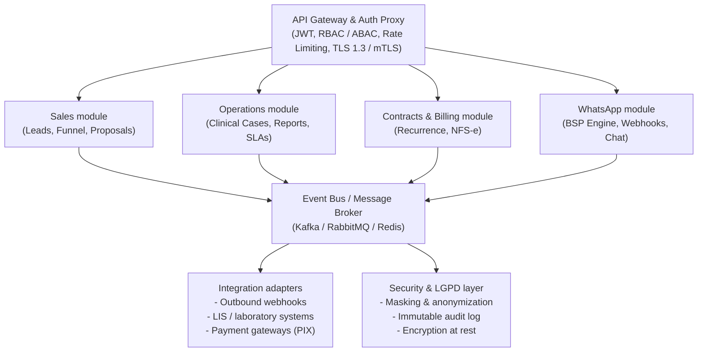

# Architecture — Flowmentor CRM

## 1. Overview

Modular monolith with **ports and adapters** and an **asynchronous event bus**. Each module exposes a `router` (HTTP) and
consumes/produces events; external integrations (Meta, S3, LLM, PIX, NFS-e, webhooks) sit behind replaceable interfaces.
The module split allows services to be extracted in the future without rewriting business rules.

```
HTTP (FastAPI) ─► service/rules ─► SQLAlchemy ─► commit ─► after_commit ─► EventBus.publish
                                                                     │
                     ┌───────────────────────────────────────────────┴────────────┐
                     ▼              ▼               ▼              ▼              ▼
              whatsapp.processor  bridge(CRM)   routing/SLA   webhooks.out   realtime(Socket.IO)
```

Reference diagram:



**Simplified outbox:** `emit(session, event, …)` only publishes **after the commit** (`db.after_commit`), preventing consumers
from reading state that does not exist yet. In production, switch to a *transactional outbox* (table + relay) if guaranteed delivery after a crash is required.

## 2. Meta webhook flow (critical path < 200 ms)

1. `POST /webhooks/whatsapp` reads the raw body, validates `X-Hub-Signature-256` (HMAC-SHA256 with `META_APP_SECRET`) and **only publishes** `whatsapp.webhook.received`.
2. It answers `200 OK` immediately — no database, no external calls.
3. The consumer (`whatsapp/processor.py`) does the processing: idempotency by `wamid`, contact, opt-in/opt-out (LGPD), survey answer,
   ticket (open/reopen), message, media → bucket, bot/handoff, routing.
4. Statuses (`sent/delivered/read/failed`) never go backwards (Meta does not guarantee delivery order).

Outbound messages: `queue_outbound` stores `queued` and publishes `message.outbound_queued`; the `outbound.py` consumer sends with retry and
updates the status. Rules: 24h window (free text only inside it; outside, an approved HSM template), opt-out and anonymization block sending.

## 3. Routing and SLA

- Strategies: **Round-Robin**, **Least Busy** and **Skill-based** (per department), plus *sticky* affinity with the last agent.
- Per-agent capacity (`max_concurrent_chats`); queues ordered by priority and waiting time; `FOR UPDATE SKIP LOCKED` on PostgreSQL.
- Dispatch triggers: an agent becomes available, a ticket is closed/transferred/queued, and a *tick* every 15 s.
- Out of hours: the ticket stays in the contingency queue and the customer receives a single notice.
- SLA: deadlines stored on the ticket (per department); a monitor every 30 s emits `sla.at_risk` (≥80%) and `sla.breached` exactly once.

## 4. Data model

Follows the supplied DDL (organizations, users, departments, contacts, tickets, messages, ticket_events, satisfaction_surveys, accounts,
account_contacts, products_services, deals, deal_items, crm_deal_tickets, lgpd_consents, audit_logs) and adds:
`whatsapp_accounts`, `wa_templates`, `media_assets`, `ticket_notes`, `agent_presence_log`, `activities` (timeline), `proposals`,
`contracts`, `invoices`, `cases`, `case_time_entries`, `case_reports`, `data_subject_requests`, `webhook_endpoints/deliveries`,
`scheduled_jobs`, `api_keys`, `refresh_tokens`.

- **Snapshots on `tickets`** (`first_response_time_seconds`, `handling_time_seconds`, `wait_time_seconds`, `is_fcr`) avoid scanning messages for KPIs.
- **`ticket_events`**: chronological history (queue × time with each agent).
- **`messages`**: partitioned by month (`created_at`) on PostgreSQL; `ensure_message_partitions` function + daily job.
- **`audit_logs`**: append-only (triggers) + a hash chain verifiable at `GET /api/v1/lgpd/audit-logs/verify`.
- Deal stages: `lead_inbound, prospeccao, qualificacao_tecnica, reuniao_alinhamento, proposta_apresentada, negociacao, fechado_ganho, fechado_perdido`
  (union of the DDL with the stages cited in the briefing; the identifiers are kept in Portuguese as stored in the database).

## 5. Commercial rules

- Items use the catalog price; **only users with `deals:discount_high` can change the unit price**.
- Suggested institutional discount = `max(value tier, account discount)`; above `discount.auto_approve_max_pct` it requires the Sales Supervisor.
- **Deal won** (`deal.won`) → contract + cases per axis (Consulting, Diagnostic Support, Medical Channel, Training); monthly recurrence generates invoices.
- Hour bank: consumption billing charges only the **excess** over the allowance, at the contract's technical hourly rate (ref. R$ 300).

## 6. Event catalog (outbound webhooks)

`account.created · contact.created · deal.created/updated/stage_changed/won/lost · proposal.sent · contract.created/status_changed ·
invoice.created/paid · case.created/updated/closed/hours_threshold · report.received/issued · sla.at_risk/breached ·
ticket.created/assigned/transferred/closed · message.received · survey.answered/detractor · lgpd.request_created/anonymized ·
template.status_changed` (live list at `GET /api/v1/webhooks/events`).

## 7. Scale and high availability

| Concern | Solution |
|---|---|
| Webhook ingestion | Answer 200 and enqueue; Redis Streams consumer groups scale horizontally; DLQ at `…:events:dlq` |
| Multi-instance real time | `socketio.AsyncRedisManager` (shared rooms; the worker can emit) — use pure WebSocket or *sticky sessions* |
| Database | Time partitioning of `messages`; read replicas for KPIs; indexes on `(ticket_id, created_at)` |
| Heavy analytics | Replace `compute_overview` with ClickHouse/Elasticsearch fed by the same bus |
| Jobs | `scheduled_jobs` table + `SKIP LOCKED`; idempotent periodic tasks |
| Media | Outside the database; signed URLs with expiry; configurable retention |

## 8. Security — control map

See the README. Operational points of attention: generate `KEK_KEYS` in a KMS/Secrets Manager, rotate with `crypto.rewrap`, restrict the
database user (no `UPDATE/DELETE` on `audit_logs`), enable encrypted backups and centralized logs without PII (`masking.scrub_text`).
